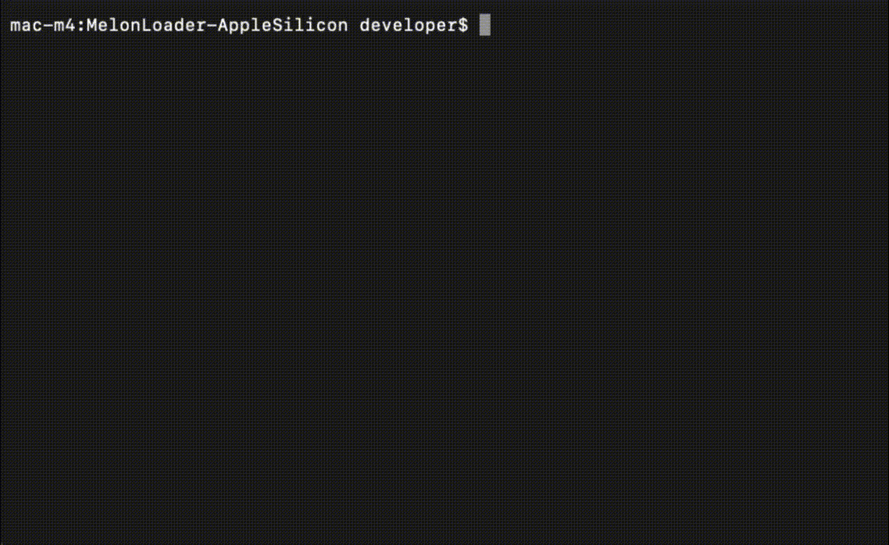
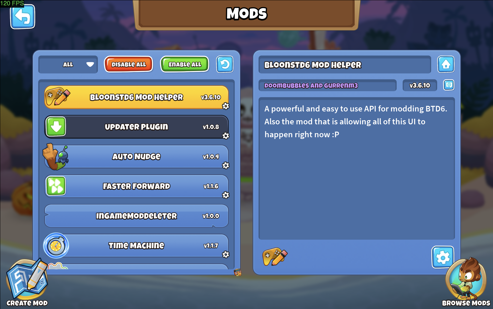
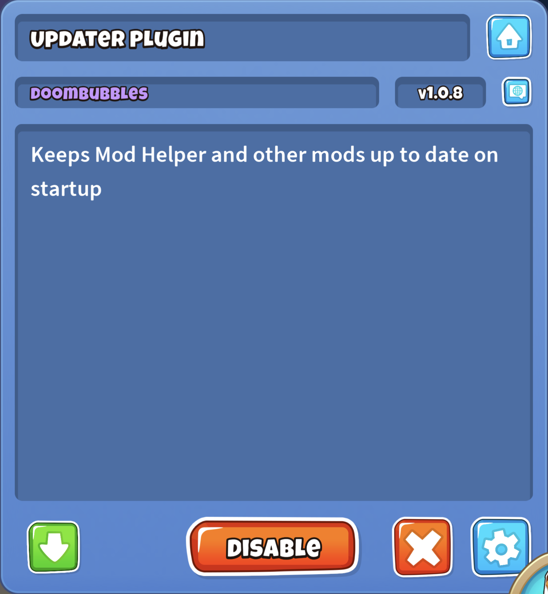
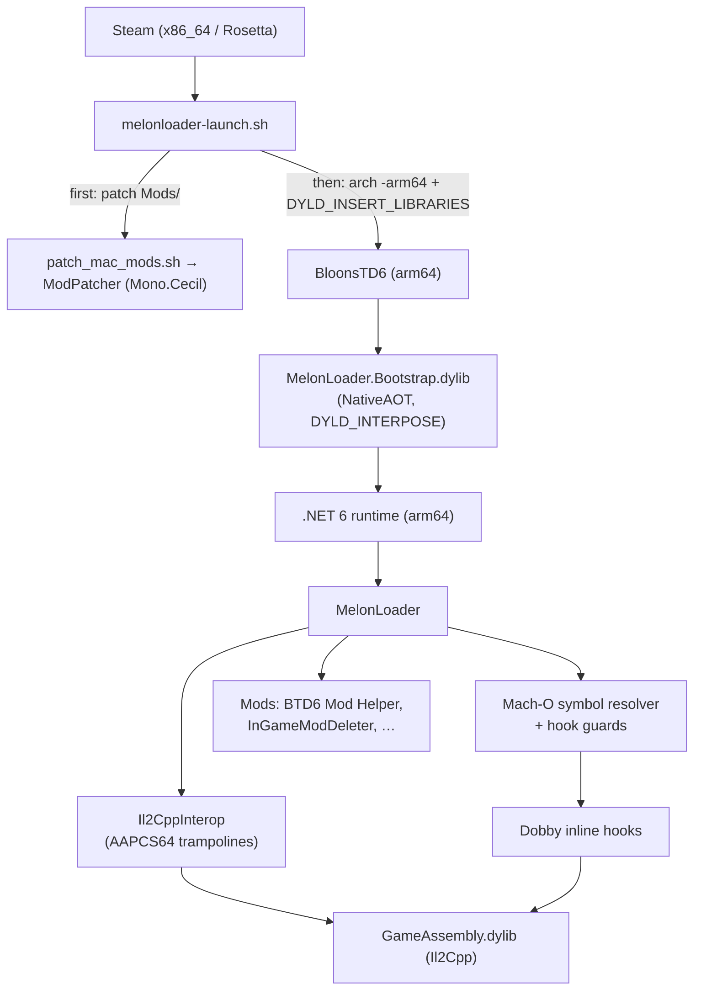

# MelonLoader for Apple Silicon: BTD6 Toolchain

[-blue)](https://github.com/Igorchk/MelonLoader/tree/macos-arm64-support)
[](#prerequisites)
[](#prerequisites)
[](LICENSE)

Tooling for running **Bloons TD 6 mods natively on Apple Silicon** with an arm64 port of [MelonLoader](https://github.com/LavaGang/MelonLoader). This repository holds the user-side toolchain that sits on top of the port:
- a patcher that rewrites x64-only mods so the arm64 .NET runtime will load them, and runs on every Steam launch;
- an in-game delete button for loaded mods in BTD6 Mod Helper's Mods menu;
- a test mod and a headless test harness for the port itself.

The loader changes live in two forks: [Igorchk/MelonLoader](https://github.com/Igorchk/MelonLoader/tree/macos-arm64-support) and [Igorchk/Il2CppInterop](https://github.com/Igorchk/Il2CppInterop/tree/macos-arm64-abi-fixes).

> **Disclaimer:** this project was vibe coded and done for fun. It isn't an official MelonLoader, Ninja Kiwi or BTD6 Mod Helper release. It is tested and stable on a MacBook Pro with an M4 Pro chip and 24 GB of RAM (macOS 26.6.2, BTD6 57.4, Unity 6000.3.23f1). See [Known Issues](#known-issues--limitations) for what doesn't work yet.

## Visuals

<p align="center">
  
  <br>
  <em><code>patch_mac_mods.sh</code> converting six x64-only mods to AnyCPU: 6 patched, 6 skipped, 0 failed.</em>
</p>

<table>
  <tr>
    <td width="62%"></td>
    <td width="38%"></td>
  </tr>
  <tr>
    <td align="center"><em>Mod Helper's Mods menu, running natively on Apple Silicon with InGameModDeleter loaded.</em></td>
    <td align="center"><em>InGameModDeleter's red ✕, between Disable and the Settings gear.</em></td>
  </tr>
</table>

## Table of Contents

- [Features](#features)
- [Prerequisites](#prerequisites)
- [Installation & Setup](#installation--setup)
  - [Quick install (recommended)](#quick-install-recommended)
  - [Manual installation (advanced / build from source)](#manual-installation-advanced--build-from-source)
- [Usage](#usage)
- [Architecture Overview](#architecture-overview)
- [Troubleshooting & FAQ](#troubleshooting--faq)
- [Known Issues & Limitations](#known-issues--limitations)
- [Contributing & License](#contributing--license)

## Features

- **Native arm64 MelonLoader for an Il2Cpp Unity 6 game.** The game, the .NET 6 runtime and every mod run as arm64, without Rosetta. Only the one-off assembly generation runs under it (Cpp2IL is x86_64-only).
- **x64-to-AnyCPU patching with Mono.Cecil.** CoreCLR on arm64 rejects assemblies built with `PlatformTarget=x64` (`FileLoadException`, HRESULT `0x80131621`) even when they're pure IL. BTD6 Mod Helper and most mods in its browser are built that way.
  - `ModPatcher` rewrites the PE header to AnyCPU (`I386`, `ILOnly`, no 32-bit flags) and leaves the IL untouched.
  - It refuses assemblies that contain native code, and it reads back what it wrote to verify it.
- **Automatic patching on every Steam launch.** The fork's `melonloader-launch.sh` runs `patch_mac_mods.sh` before the game starts, so mods downloaded through Mod Helper's browser load on the next launch.
  - Every original is backed up before it's patched.
  - Output goes to `MelonLoader/AutoPatch.log` and the MelonLoader Terminal window.
  - A failed patch never blocks the launch.
- **Live deletion of loaded mods (InGameModDeleter).** It adds a delete button for running mods to Mod Helper's Mods menu, which normally only lets you delete mods that are disabled and weren't loaded this session.
  - No file lock has to be bypassed: macOS, like any POSIX system, lets a process remove a file it has open.
  - `File.Delete` unlinks the DLL from `Mods/` while the loaded assembly keeps running until the game restarts.
- **Correct arm64 calling conventions in Il2CppInterop.** Structs of up to 16 bytes are passed in registers, and large structs are returned through `x8`. These are AAPCS64 rules. Before the fix, `[OnDeserialized]` callbacks taking a `StreamingContext` crashed in `Object::Box`.
- **Symbol-based hook resolution.** `GameAssembly.dylib` keeps its symbol table, so Il2CppInterop's class-injection hooks are found by mangled name, with the ASLR slide checked. Il2CppInterop's own scanner only understands x86.
- **Guard for hooks on tiny functions.** Dobby's arm64 inline hook is 16 bytes. MelonLoader now refuses to hook game functions smaller than that, instead of overwriting the next function. Without the guard, BTD6 Mod Helper's patch on the 12-byte `Btd6Player.Save` corrupted `Btd6Player.Sync` and the game died with `SIGILL` at the first round end.
- **Guard for hooks that cross a page boundary.** Dobby's macOS code patcher only writes the one memory page where a patch starts, so a 16-byte patch running into the next page crashed the game (`SIGSEGV` in `memmove`; AbilityChoice hit this on every launch). MelonLoader refuses those hooks too.
- **Steam-safe launcher.** Steam starts launch options from an x86_64 (Rosetta) process tree. The launcher starts the game with `arch -arm64` and passes `DYLD_*` with `arch -e`, because SIP strips those variables from protected binaries.

## Prerequisites

| Requirement | Details |
| --- | --- |
| Hardware | Apple Silicon (arm64) Mac. Tested on an M4 Pro. |
| macOS | Tested on macOS 26.6.2. The bootstrap is compiled with `-mmacosx-version-min=12.0`; older versions haven't been tested. |
| Rosetta 2 | Needed once, for Cpp2IL during first-time assembly generation: `softwareupdate --install-rosetta --agree-to-license` |
| Game | Bloons TD 6 from Steam (tested: 57.4, Unity 6000.3.23f1), with the Steam client running |
| .NET SDK | Builds everything here. Tested with the .NET 10 SDK; the projects target `net6.0`. At run time, the patcher uses the .NET 6 runtime MelonLoader installs into the game folder. |
| Xcode Command Line Tools | `clang`, `lipo` and `codesign` for building the bootstrap and preparing the game: `xcode-select --install` |
| Git, GitHub CLI (optional) | For cloning the forks |
| BTD6 Mod Helper 3.6.10 | Only for InGameModDeleter, which builds against `Mods/Btd6ModHelper.dll` |

## Installation & Setup

### Quick install (recommended)

One command does everything below: finds your BloonsTD6 install (or lets you pick the folder), clones and builds the patcher toolchain, thins and re-signs the game bundle, downloads and extracts the latest MelonLoader + Il2CppInterop release, clears the Gatekeeper quarantine flag, and swaps in a launcher wrapper so the game loads mods straight from Steam - **no Steam Launch Option to set by hand**. Status is shown as native macOS dialogs as well as in the terminal.

```bash
bash -c "$(curl -fsSL https://raw.githubusercontent.com/Igorchk/MelonLoader-AppleSilicon/main/install.sh)"
```

It's safe to re-run: each step is skipped if it's already done, and the original app is backed up to `~/BloonsTD6.app.orig` before anything is changed. A Steam update or **Verify integrity of game files** restores the stock app and undoes the swap - just run the command again afterwards. Read `install.sh` before running it, same as with any script piped into `bash`.

### Manual installation (advanced / build from source)

Prefer to see every step, or need to build from source instead of the release zip? The commands below assume the default Steam library:

```bash
export BTD6="$HOME/Library/Application Support/Steam/steamapps/common/BloonsTD6"
```

### 1. Get the loader

**Option A: release zip.** Download `MelonLoader-macOS-arm64-v0.7.4-hotfix5.zip` from the [hotfix5 release](https://github.com/Igorchk/MelonLoader-AppleSilicon/releases/tag/v0.7.4-hotfix5) and extract it into the game folder. It already contains the patched Il2CppInterop DLLs and the auto-patching launcher.

```bash
unzip MelonLoader-macOS-arm64-v0.7.4-hotfix5.zip -d "$BTD6"
```

**Option B: build from source.**

```bash
git clone -b macos-arm64-support https://github.com/Igorchk/MelonLoader.git
cd MelonLoader
dotnet build MelonLoader.sln -c Release -p:Platform=arm64 -p:ForceRID=osx-arm64
cp -R Output/Release/osx-arm64/MelonLoader Output/Release/osx-arm64/MelonLoader.Bootstrap.dylib Output/Release/osx-arm64/melonloader-launch.sh "$BTD6/"
cd ..
```

Then build the patched Il2CppInterop and replace the stock DLLs. Its `global.json` pins SDK 8.0, so run the build from outside the clone if you only have a newer SDK:

```bash
git clone -b macos-arm64-abi-fixes https://github.com/Igorchk/Il2CppInterop.git
dotnet build Il2CppInterop/Il2CppInterop.HarmonySupport/Il2CppInterop.HarmonySupport.csproj -c Release
cp Il2CppInterop/bin/Il2CppInterop.Runtime/net6.0/Il2CppInterop.Runtime.dll \
   Il2CppInterop/bin/Il2CppInterop.HarmonySupport/net6.0/Il2CppInterop.HarmonySupport.dll \
   "$BTD6/MelonLoader/net6/"
```

### 2. Prepare the game bundle

Back up the app first, outside the game folder, because the launcher expects exactly one `.app` next to it. Then thin `GameAssembly.dylib` to arm64 (Cpp2IL can't read universal binaries), and ad-hoc re-sign the app (the shipped Hardened Runtime lacks `allow-jit`, so .NET can't start):

```bash
cd "$BTD6"
ditto BloonsTD6.app ~/BloonsTD6.app.orig
lipo -thin arm64 BloonsTD6.app/Contents/Frameworks/GameAssembly.dylib -output /tmp/GameAssembly.dylib
mv /tmp/GameAssembly.dylib BloonsTD6.app/Contents/Frameworks/GameAssembly.dylib
codesign --force --deep --sign - BloonsTD6.app
```

A Steam update, or **Verify integrity of game files**, restores the original app. Repeat this step afterwards.

### 3. Set the Steam launch option

(Skip this if you used the quick installer above - it swaps the game binary itself instead, so no Launch Option is needed.)

In Steam, open Bloons TD 6 → **Properties** → **General** → **Launch Options**, and enter the launcher's absolute path, quoted:

```
"/Users/<you>/Library/Application Support/Steam/steamapps/common/BloonsTD6/melonloader-launch.sh" %command%
```

The first launch downloads the .NET 6 arm64 runtime and Cpp2IL, then generates the Il2Cpp assemblies, which takes about a minute. Later launches skip this.

### 4. Install this toolchain

The launcher looks for the patcher at `~/Documents/Coding/BTD6-Mods/MelonLoader-AppleSilicon/patch_mac_mods.sh`. Clone this repository there:

```bash
git clone https://github.com/Igorchk/MelonLoader-AppleSilicon.git ~/Documents/Coding/BTD6-Mods/MelonLoader-AppleSilicon
cd ~/Documents/Coding/BTD6-Mods/MelonLoader-AppleSilicon

# The patcher (needs the .NET SDK once; at run time it uses the game's own runtime)
(cd ModPatcher && dotnet build -c Release -o bin)

# InGameModDeleter (needs MelonLoader to have run once, and BTD6 Mod Helper in Mods/)
(cd InGameModDeleter && dotnet build -c Release)
cp InGameModDeleter/bin/Release/net6.0/InGameModDeleter.dll "$BTD6/Mods/"
```

To keep the toolchain somewhere else, set `MELONLOADER_PATCH_SCRIPT` to the script's full path in the environment that starts the launcher. Set it to an empty string to turn auto-patching off.

## Usage

### Automated Steam launch

Launch BTD6 from Steam as usual. `melonloader-launch.sh` then:

1. Resolves the game binary from the `.app` path Steam passes.
2. Runs `patch_mac_mods.sh` on the game's `Mods/` folder, before `DYLD_INSERT_LIBRARIES` is set so the patcher's own .NET process isn't injected:
   ```
   Auto-patching x64 mods to AnyCPU...
   ok     Btd6ModHelper.dll (already loads on arm64)
   PATCH  AutoNudge.dll (x64 -> AnyCPU)
   PATCH  FasterForward.dll (x64 -> AnyCPU)

   2 patched, 1 skipped, 0 failed
   Originals backed up to ~/Library/Application Support/Steam/steamapps/common/BloonsTD6/ModPatcher-backups/20261104-025149
   ```

   Paths are printed with your home folder shown as `~`, so recordings and logs don't reveal your macOS account name.
   The output is saved to `MelonLoader/AutoPatch.log` and shown at the top of the MelonLoader Terminal window. If the patcher can't be found or read, for example because macOS privacy settings stop Steam from reading `~/Documents`, the log says so and the game still launches.
3. Opens a Terminal window that follows `MelonLoader/Latest.log`. Set `MELONLOADER_NO_TERMINAL=1` to skip it.
4. Exports `DOTNET_TieredCompilation=0`, then starts the game with `arch -arm64` and the bootstrap in `DYLD_INSERT_LIBRARIES`.

You can also run the patcher by hand, with the game closed:

```bash
~/Documents/Coding/BTD6-Mods/MelonLoader-AppleSilicon/patch_mac_mods.sh            # the Steam BloonsTD6/Mods folder
~/Documents/Coding/BTD6-Mods/MelonLoader-AppleSilicon/patch_mac_mods.sh path/to/mods
```

It only rewrites .NET assemblies that `file` reports as x86-64, and skips everything else. It exits non-zero if any patch failed.

### Vanilla / Modded Toggle

Co-Op and other online modes can flag an account for running a modded client. `toggle_mods.sh` switches the next launch between modded and a clean, unmodified vanilla client, so you can play online safely and switch back afterward:

```bash
~/Documents/Coding/BTD6-Mods/MelonLoader-AppleSilicon/toggle_mods.sh
```

It shows the current status in a dialog (**VANILLA** or **MODDED**) with a button to switch. In vanilla mode, the launch wrapper skips both the mod patcher and the MelonLoader injection entirely - it's the unmodified game binary, nothing else running.

### In-game mod deletion

1. On the main menu, open Mod Helper's **Mods** menu.
2. Select a mod in the list on the left.
3. In the selected mod's button row, click the red **✕** one slot left of the Settings gear. It only appears for mods that are enabled, loaded and present on disk, and never for Mod Helper itself.
4. Confirm. The mod's DLL is deleted from `Mods/`, along with Mod Helper's cached `.json`/`.png` for it, and a popup reports:
   > Mod deleted from disk. Due to Unity engine limitations, the mod will remain active in memory until you restart the game.

To remove a mod you've already disabled this session, use Mod Helper's own ✕ after a restart.

### Development tools

- `tools/MacArm64TestMod` is a probe mod. It logs lifecycle callbacks and Harmony patch hits, checks that a non-default `StreamingContext` reaches a patched method intact, and calls `Btd6Player.Save` then `Btd6Player.Sync` to catch broken short hooks.
- `tools/run_test_unattended.sh [timeout] [output_dir]` launches the game headless, waits until the mods have loaded or loading fails, stops the game and saves `Latest.log`.
  - `ML_DEBUG=1` turns on debug logging.
  - `ML_SETTLE=<seconds>` keeps the game running for longer after the mods load.
  - The Steam client has to be running, and unattended runs stop at the title screen.

## Architecture Overview



- **Launch layer** (`melonloader-launch.sh`, in the MelonLoader fork):
  - It goes around LaunchServices, which would drop `DYLD_INSERT_LIBRARIES`.
  - It runs the patcher, then starts the game as the bootstrap's architecture.
- **Bootstrap** (`MelonLoader.Bootstrap.dylib`):
  - A NativeAOT library plus a small C++ shim that uses `DYLD_INTERPOSE` on `setrlimit` and `dlsym`.
  - It loads hostfxr from the portable .NET 6 runtime and redirects `il2cpp_init` and `il2cpp_runtime_invoke` to start MelonLoader.
  - It removes itself from `DYLD_INSERT_LIBRARIES` so that child processes such as the x86_64 Cpp2IL don't inherit it.
- **Translation layer** (Il2CppInterop): generated managed proxies call into Il2Cpp, and native-to-managed trampolines carry calls back. The fork changes those trampolines to follow AAPCS64 for structs passed by value and returned by value.
- **Hook layer** (`NativeUtils/MachOParser`, `BootstrapInterop`):
  - It reads `LC_SYMTAB` from every instruction section in `__TEXT`, including Unity 6's separate `__TEXT,il2cpp` section of generated game code. Every offset is bounds-checked.
  - It computes the ASLR slide from two exports.
  - It resolves Il2CppInterop's hook targets by name, following single-`b` thunks.
  - Every native hook first measures its target, and refuses functions smaller than Dobby's 16-byte patch, and patches that would cross a page boundary.
- **User toolchain** (this repository):
  - `patch_mac_mods.sh` drives `ModPatcher`.
  - InGameModDeleter uses a Harmony postfix on Mod Helper's internal `ModsMenu.SetSelectedMod`. It reaches `ModHelperData` through Mod Helper's own assembly, because the Updater Plugin ships a partial copy of that type under the same name.

| Path | Purpose |
| --- | --- |
| `patch_mac_mods.sh` | Finds x86-64 .NET mods, backs them up, and patches and verifies them with ModPatcher |
| `ModPatcher/` | Mono.Cecil console app (`cecilpatch`). Exit codes: `0` patched, `1` error, `2` already AnyCPU |
| `InGameModDeleter/` | MelonLoader mod adding the live-delete button to Mod Helper's Mods menu |
| `tools/MacArm64TestMod/` | Probe mod for lifecycle, Harmony, struct ABI and short-hook checks |
| `tools/run_test_unattended.sh` | Headless launch-and-check harness |

## Troubleshooting & FAQ

**"[App] is damaged and can't be opened. You should move it to the Trash" (Gatekeeper).**
macOS tags anything downloaded from the internet, including a cloned repo or an extracted zip,
with a `com.apple.quarantine` extended attribute. Gatekeeper then refuses to run the unsigned or
ad-hoc-signed binaries in it (`BloonsTD6.app`, `MelonLoader.Bootstrap.dylib`, the patcher's
`cecilpatch.dll`), reporting them as "damaged" rather than "unsigned." Strip the attribute
recursively from the folder and try again:

```bash
xattr -cr /path/to/your/Mods/or/game/folder
```

Run it on the BTD6 game folder (`$BTD6` in the commands above) after extracting a release zip or
re-signing the app, and on `Mods/` after downloading new mods, if either still won't launch.

**`FileLoadException` (`0x80131621`) - a mod won't load.**
BTD6 Mod Helper's mod browser, and most mods in it, are built `PlatformTarget=x64` for Windows.
The arm64 .NET runtime on Apple Silicon refuses to load an x64-targeted assembly outright, even
when it's pure IL - that's this exception. It means the mod hasn't been patched to `AnyCPU` yet.

- If you're launching through Steam with the toolchain installed (see [Installation & Setup](#installation--setup)), this should already be automatic: `melonloader-launch.sh` runs `patch_mac_mods.sh` before every launch. Check `MelonLoader/AutoPatch.log` for why a specific mod wasn't patched.
- Otherwise, run the patcher by hand with the game closed:
  ```bash
  ~/Documents/Coding/BTD6-Mods/MelonLoader-AppleSilicon/patch_mac_mods.sh
  ```
- If it still fails after patching, check the exception's inner message in `MelonLoader/Latest.log` - the mod may contain actual native (non-IL) code, which patching can't fix.

## Known Issues & Limitations

- **Deleted mods stay loaded until a restart.** The .NET runtime can't unload an assembly from the default `AssemblyLoadContext`, so a mod deleted in game keeps running until the game closes. The in-game message attributes this to Unity, but the limit comes from .NET.
- **Mod Helper's mod browser installs x64 builds.** Downloaded mods only load after `patch_mac_mods.sh` has run, which the launcher does on the next start.
- **Game functions under 16 bytes can't be hooked from game code.** MelonLoader refuses those hooks and logs `Refusing to patch … because it is too small for an ARM64 detour`. In BTD6, this affects Mod Helper's patch on the 12-byte `Btd6Player.Save`, and a patch on the 4-byte `EditorMenuPopout.OnPlaceablesPlacedOrRemoved` that appears once Useful Utilities is installed. Calls from mods still reach those patches; calls from the game run the original. Dobby's near-branch mode isn't a fix, because on macOS it reused zero-filled pages inside Il2Cpp's GC heap.
- **Hooks that would cross a memory page boundary are refused the same way**, logged as `Refusing to patch … because its ARM64 detour would cross a memory page boundary`. With AbilityChoice 4.5.0 this affects one hook. The real fix belongs in Dobby's macOS code patcher.
- **Tiered compilation is off** on osx-arm64, so the JIT can't replace Harmony detours. Startup JIT is slower. The underlying mechanism is inferred, not proven.
- **Patched methods can't return structs larger than 16 bytes.** Harmony can't bind the fixed-size struct type for such a return, so the patch fails with `FileLoadException`.
- **No xref cache on arm64.** Il2CppInterop's xref scanner only decodes x86, so mods that use `XrefScanner` at run time won't work.
- **The game bundle is modified.** The ad-hoc signature drops the game's entitlements (iCloud, push notifications), and Steam updates or file verification undo both the re-signing and the thinning.
- **InGameModDeleter depends on Mod Helper 3.6.10 internals.** If a later version renames them, it logs what's missing and the button doesn't appear. On Windows, deleting a loaded DLL fails, and it reports the error instead.
- **Mods built for another game version can fail independently of arm64.** For example, BTD6Rogue 3.1.0 can't find some compiler-generated `MenuManager` types in BTD6 57.4.
- **Coverage is narrow.** Testing used one game on one machine. A crash during shutdown after a `SIGTERM` (Discord SDK, Metal render thread, Il2Cpp thread pool) is known noise.

## Contributing & License

### Contributing

- **Where changes go:**
  - Loader and runtime changes belong in the forks, and from there upstream. The open pull requests are [LavaGang/MelonLoader#1231](https://github.com/LavaGang/MelonLoader/pull/1231) (into `alpha-development`) and [BepInEx/Il2CppInterop#294](https://github.com/BepInEx/Il2CppInterop/pull/294).
  - Keep personal tooling, such as the auto-patch step and local paths, out of upstream branches. It lives on the fork's `macos-arm64-support` branch and in this repository.
- **Testing:** before opening a PR, build for `osx-arm64`, then run `tools/run_test_unattended.sh` with `ML_DEBUG=1` and `MacArm64TestMod` installed. Include the relevant `Latest.log` lines in the PR. For changes to cross-platform code, also check that the managed projects build for `win-x64` and `linux-x64`.
- **Conventions:** keep macOS-only code behind `#if OSX && ARM64 && NET6_0_OR_GREATER`, and match the surrounding style.
- **Commits:** use [Conventional Commits](https://www.conventionalcommits.org/) (`feat:`, `fix:`, `docs:`, `chore:`).

### License

The code in this repository is licensed under the [Apache License 2.0](LICENSE), copyright (c) 2026 Igorchk. Each script and source file has an `SPDX-License-Identifier: Apache-2.0` header.

This project depends on the following projects. None of their code is vendored here:

| Project | License | Relationship |
| --- | --- | --- |
| [MelonLoader](https://github.com/LavaGang/MelonLoader), © Lava Gang | Apache-2.0 | Mod loader everything here runs on. The arm64 port is in the [Igorchk/MelonLoader](https://github.com/Igorchk/MelonLoader) fork. |
| [Il2CppInterop](https://github.com/BepInEx/Il2CppInterop), © BepInEx | LGPL-3.0 | Il2Cpp interop layer. The AAPCS64 trampoline fix is in the [Igorchk/Il2CppInterop](https://github.com/Igorchk/Il2CppInterop) fork. |
| [BTD6 Mod Helper](https://github.com/gurrenm3/BTD-Mod-Helper), © gurrenm3 and doombubbles | GPL-3.0 | InGameModDeleter compiles against it and patches it at run time, without including any of its code. The FSF considers Apache-2.0 compatible with GPL-3.0. |
| [Mono.Cecil](https://github.com/jbevain/cecil), © Jb Evain | MIT | Used by ModPatcher, which gets it from NuGet at build time. |

No Bloons TD 6 files are included. The test mod and InGameModDeleter compile against the Il2Cpp assemblies MelonLoader generates in your own game folder. Bloons TD 6 is a trademark of Ninja Kiwi. This project isn't affiliated with or endorsed by Ninja Kiwi, LavaGang, BepInEx or the BTD6 Mod Helper authors.
